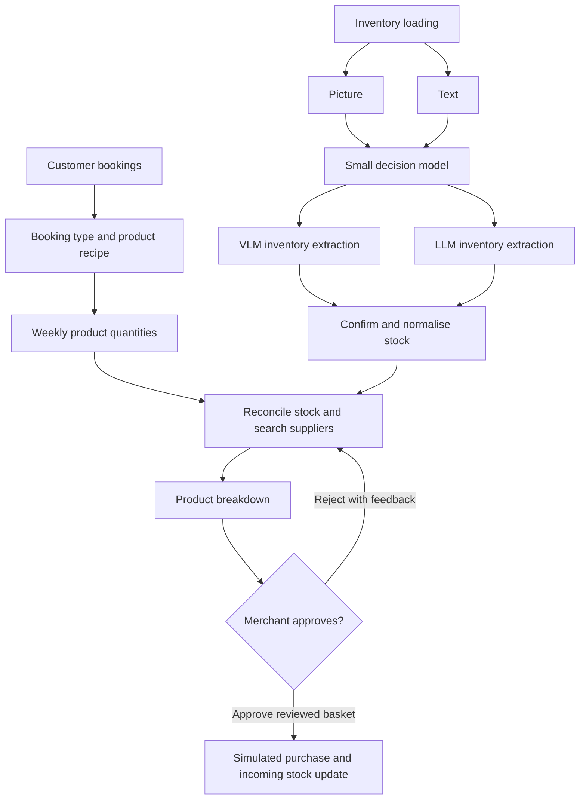

# Iris

> **Never run out of what's booked.**

Iris turns next week's appointments and a merchant's stock count into a supplier basket. The owner can see which booking will run short, why an item is needed and which supplier can get it there in time. If they reject a proposal, Iris searches again using their feedback. Approval creates a simulated order and updates incoming inventory.

**Event** · Retail AI & Agents Hackathon, Innovators Guild at Fresha · 24 November 2026 · Retail AI track (Nebius / NVIDIA) · BuilderBase submission by **20:00 London time**. [Event brief](https://luma.com/1ri4tr1c)

## User and demo

Build for the owner or manager of an appointment-based business that consumes stock during services. Use a barbershop as the single full demo. The same schema should support a tattoo studio or other booking business through different service recipes and product data.

The barbershop has textured crop bookings coming up and a low count of matte clay. A stock photo or pasted count gives Iris the inventory snapshot. The schedule shows when the clay runs short. Iris finds the same product from suppliers, shows the price and delivery trade-off, and revises the basket when the owner rejects an offer.

## Architecture



### 1. Turn bookings into weekly product quantities

- Load synthetic upcoming appointments. Map each booking type to a configured recipe with product IDs and per-service quantities. Exclude cancelled bookings and flag missing recipes.
- Optional booking-note interpretation can suggest a bounded, product-specific adjustment from the configured recipe rules. Validate the adjustment and use the base recipe when the note cannot be resolved. Keep note interpretation separate from inventory intake.
- Compute seven-day product demand in Python from the recipe quantities and booking counts. Use a fixed demo clock and the business time zone. The dashboard can extend to 14 days once the seven-day workflow works.
- Compare equal-length windows if history is available. Generate trend captions from computed counts, with sample data that actually supports the claim. The upcoming bookings determine the order forecast.

### 2. Load stock through separate picture and text paths

- The lightweight decision router receives the input modality and chooses the model. A photo always goes to the VLM, and pasted stock text always goes to the LLM. Route mixed submissions as separate inputs. Use a small explicit modality dispatcher for the sprint since the UI already knows the input type.
- The VLM reads visible product labels and counts from a staged stocktake photo. Use a clearly readable shelf or count sheet with stock quantities visible. The LLM converts pasted notes such as “2 × Brand X Matte Clay 100 ml, 35 neck strips” to the same schema.
- Both return candidate observations with a raw label, possible SKU, observed quantity and unit, evidence and any ambiguity. Validate rows in code, resolve them against the product master and show the merchant a review table. Missing or obscured counts stay unknown until corrected. Require confirmation before observations affect stock. For the sprint, treat confirmed inputs as absolute on-hand counts per SKU and overwrite only confirmed rows.
- Seed a demo stock snapshot for unrelated products. Make the hero SKU's confirmed input change the forecast so judges can see that the intake is connected.

### 3. Reconcile projected demand and run agentic supplier search

- Process booked usage and confirmed incoming deliveries in time order. Calculate projected stock, uncovered quantity and the first booking that cannot be served per SKU. Include only inbound units due before the relevant booking. Surface unknown stock and unmatched items for review. A confirmed SKU with adequate coverage needs no supplier search.
- Give the sourcing agent a SKU, required amount, need-by time, prior rejections and merchant constraints. It plans a targeted search and calls a typed, read-only catalog tool, using the licensed NVIDIA Retail Shopping Assistant reference described below. Tavily is the live supplier discovery adapter when credentials are available. Query with the exact product or SKU and region. Keep each source URL and retrieval timestamp.
- Normalise seller listings to the same SKU, pack size, available quantity, price, delivery and shipping terms. Validate price and delivery evidence before an offer is eligible for the proposed basket. A result with missing or conflicting details stays a lead. Seed two eligible on-time offers and one cheaper late offer for the hero SKU so the rejection loop and price trade-off both work without live offers.
- In code, filter offers to the required brand, variant and unit size, allowing different pack counts of the same item. Calculate packs, delivered cost and delivery before the first uncovered appointment. Rank verified on-time options first by delivered cost, with merchant preferences such as supplier or budget applied. Show late options with their uncovered demand as a fallback. AI explains the supported trade-off using the ranked results.
- Return one product breakdown per shortage with the weekly demand, confirmed on-hand, inbound coverage, projected shortage and time, affected bookings, recommended pack count, supplier, price and shipping, ETA, line and basket totals, source and one plain-English reason. Include an alternative offer when available.

### 4. Review, search again, or simulate the order

- Present the product breakdown as a proposed basket. Support approval, quantity edits, removal and rejection with an optional reason. Recompute totals and coverage when the merchant edits quantities. Each changed proposal requires its own approval.
- Rejection sends the rejected offer and feedback back to supplier search for the affected SKU or basket. Keep approved or untouched lines where appropriate. Exclude rejected offers for that revision and search again within the same product rules. If no alternative qualifies, show the unmet need. Preserve both proposal revisions so the merchant can see what changed.
- Only the app's merchant approval action can execute the simulated order. Check the latest proposal and approved quantities again before execution. Write the order and pending inbound quantities together and guard against duplicate submissions. On-hand increases when stock is marked received. A rerun considers approved inbound stock once, at its ETA. Draft supplier emails only if there is time.
- If showing impact, compare the projected appointments missed before and after the chosen order arrives. Count each protected booking once. Label the total as estimated booking revenue covered and keep it separate from any supplier price saving.

## NVIDIA blueprints and Nebius

| Reference | How Iris uses it |
|---|---|
| [NVIDIA Retail Shopping Assistant](https://build.nvidia.com/nvidia/retail-shopping-assistant) and its [upstream tool reference](https://github.com/NVIDIA-AI-Blueprints/retail-shopping-assistant/blob/main/docs/TOOLS.md) | Primary reference for sourcing. Adapt the `search_catalog_tool` pattern into one typed read-only supplier search tool with a clear schema, hard filters, deterministic ranking and evidence returned to the agent. In the first integration spike, check whether a small upstream schema or helper can be reused independently under its licence. Record the upstream URL, pinned revision and what Iris actually uses in the submission. |
| [NVIDIA Retail Catalog Enrichment](https://build.nvidia.com/nvidia/retail-catalog-enrichment) | Use its visual product analysis pattern to extract structured identity attributes from stock photos, then validate and match them against Iris's SKU catalog. The merchant needs usable stock fields such as product, variant, size and count. |
| [NVIDIA Multi-Agent Intelligent Warehouse](https://build.nvidia.com/nvidia/multi-agent-intelligent-warehouse) | Reference for separate forecasting and replenishment responsibilities. Use booking recipes and a time-ordered stock projection for the barbershop's demand calculation. |
| [NVIDIA Retail Agentic Commerce](https://build.nvidia.com/nvidia/retail-agentic-commerce) | Reference for the basket and order lifecycle under merchant control. Iris has one local simulated order path. ACP, UCP and payments are future supplier integrations. |
| [Nebius webinar](https://nebius.com/events/webinar-production-ready-retail-store-agents) and [Nebius blueprint deployment write-up](https://nebius.com/blog/posts/retail-ai-agents-nvidia-blueprints-nebius) | The Store Operations Agent Harness is the reference for routing vision versus text inputs and requiring manager approval before execution. Inventory Lab offers future replenishment simulation ideas. For the demo Nebius hosts model inference via Token Factory. |

Unmodified Apache-2.0 reference copies of the four NVIDIA blueprints are in `blueprints/`. `blueprints/README.md` lists the pinned upstream commits to record in the submission.

Use the existing Python and Streamlit approach for the app. Call Nebius Token Factory from the server via the OpenAI-compatible client. Smoke-test one structured text/tool response and one image request as soon as credentials arrive. Prefer an available NVIDIA Nemotron for text and sourcing, and use a confirmed image-capable Nebius endpoint for the VLM. Verify exact model IDs, capabilities and access in the [Token Factory catalogue](https://tokenfactory.nebius.com/models/catalog). Configure them separately, with a dedicated endpoint override if the team already has one. The app can run locally for the demo. Describe which reference patterns, models and components actually ran when submitting.

Use bounded requests with timeouts. Prepare a labelled demo replay of extraction outputs and supplier offers so the photo/text processing, rejection and approval remain demonstrable if a live endpoint fails. Use only staged photos, synthetic bookings and public supplier listings. Treat supplier page text as evidence and keep it outside the model's instructions and write tools. [Tavily Search API](https://docs.tavily.com/documentation/api-reference/endpoint/search)

## Implementation surface

Keep one Streamlit app, small Python modules and one repeatable barbershop fixture. Use the repo's conventions where available.

```text
app.py              Inventory review, run-out timeline, sourcing basket, confirmation
iris/data.py        Presets, canonical product IDs and demo clock
iris/intake.py      Text/photo router, extraction schema, validation and SKU matching
iris/calc.py        Booking recipes, seven-day demand, stock projection and impact
iris/sourcing.py    Typed catalog tool, fixture/Tavily adapters, offer validation and ranking
iris/agent.py       Sourcing requests, evidence-grounded reasons and rejection feedback
iris/llm.py         Nebius text and vision client
iris/orders.py      Approved proposal revisions, simulated orders and inbound records
data/               Synthetic bookings/history, product recipes, stocktake and offers
```

Minimum records and joins:

| Record | Fields that matter |
|---|---|
| Booking and recipe | Booking ID, service ID, appointment time, status, optional notes. Recipe rows join service ID to SKU and quantity in a base unit. |
| Product and stock | SKU, aliases, brand, variant, base unit, stock observations, on-hand quantity, confirmed incoming deliveries. Use millilitres for clay and units for neck strips. |
| Forecast line | SKU, seven-day usage, on-hand, incoming by date, uncovered amount, first at-risk appointment and contributing booking IDs. |
| Supplier offer | Offer ID, SKU match evidence, units per pack, availability, pack price, shipping, ETA, evidence URL or fixture label, retrieved time. |
| Proposal and order | Basket ID, revision, selected offer and packs per line, totals, exclusions and feedback, approval status, simulated order and incoming lines. |

Create or merge `.env.example` with these keys. Use `https://api.tokenfactory.nebius.com/v1/` when `NEBIUS_BASE_URL` is unset.

```dotenv
NEBIUS_API_KEY=
NEBIUS_BASE_URL=
IRIS_TEXT_MODEL=
IRIS_VISION_MODEL=
IRIS_VISION_BASE_URL=
TAVILY_API_KEY=
```

## Sprint to 20:00 London time

| By | Deliverable |
|---|---|
| 18:00 | Agree SKU, forecast and proposal schemas. Seed the clay shortage and two alternate supplier offers. Smoke-test Nebius text and image input, Tavily access and the blueprint tool seam. |
| 18:45 | Stitch the path from validated text or fixture stock into the forecast, sourcing basket, rejection and simulated order. Re-run after order creation and show the pending stock. |
| 19:15 | Connect real photo and text extraction where available. Try one evidence-backed live supplier lookup. Keep the labelled fixture run ready for the demo. |
| 19:35 | Run the end-to-end acceptance checks, polish the timeline and make a short backup recording. |
| 19:50 | Prepare the BuilderBase entry with the pitch, repo link, screenshots or clip, blueprint usage and the live versus simulated components. Submit before 20:00. Sign up for the demo slot with the facilitator if presenting. |

Proposed split. Confirm the owners in team chat.

| Owner | Work |
|---|---|
| Tudor (`tizzy1`) | Synthetic data, service recipes, time-ordered forecast and acceptance fixtures. |
| Om (`Infosuii`) | Nebius vision/text integration, inventory router and extraction review contracts. |
| CriticalRegion | NVIDIA sourcing reference, Tavily and fixture adapters, ranking and rejection feedback. |
| Abhi (`abhit-7`) | Streamlit flow, approval and simulated order state, demo and BuilderBase materials. |

Om or Abhi publishes the initial idea docs to GitHub. Keep one complete workflow as the milestone. Cut Ask Iris chat, extra presets, supplier emails, history polish and the 14-day view first. Real Fresha integration, live ordering, real payments, accounts, mobile and deployment of the full blueprint stacks are outside the sprint.

## Demo and acceptance

1. Upload the staged barbershop stock photo, confirm the detected clay count and show the text intake pathway briefly or cover it in the recording. Change one count and show that the forecast changes.
2. Run Iris. Point to the first appointment at risk and the booked services responsible. Show offers for the same SKU, including price and delivery evidence. Explain why the cheaper seller misses the Friday booking.
3. Reject the proposed supplier. Show the exclusion or feedback on the revised basket, and show that there is still no order.
4. Approve the revised basket. Show one simulated order, new incoming stock and the updated coverage. Retry approval to verify there is still one order. Show on-hand and incoming separately.
5. If time remains, switch to the tattoo preset or answer a booking-grounded “Why so much clay?” The barbershop loop is the submission.

Check a blurry or unreadable count, a listing with the same name and the wrong size, unknown live delivery, a late offer, no alternative after rejection, and a second approval click. Use the seeded baseline to check those outcomes before recording.
