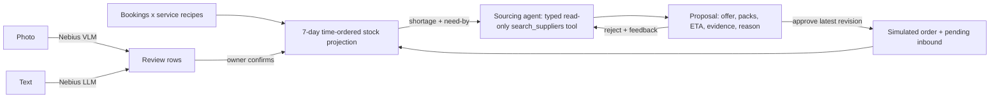

# Iris

> **Never run out of what's booked.**

Salons and barbershops know their demand a week ahead: it's in the booking book. Iris turns next week's appointments and a quick stock count (a photo or a pasted note) into a supplier basket the owner can approve. It shows which booking will run short, why the product is needed, and which supplier can deliver in time. If the owner rejects a proposal, Iris searches again using their feedback. Approval places a simulated order and records the incoming stock.

Built at the Retail AI & Agents Hackathon (Innovators Guild at Fresha, London, 24 Nov 2026), Retail AI track (Nebius / NVIDIA).

## Run it

```bash
python3.14 -m venv .venv && .venv/bin/pip install -r requirements.txt
cp .env.example .env            # optional: Nebius + Tavily keys; without them Iris uses labelled fallbacks
.venv/bin/streamlit run app.py  # http://localhost:8501
```

Checks: `python scripts/check.py` (unit tests) and `python scripts/acceptance.py` (17 headless end-to-end checks against the app).

## Demo path

1. **Stock count**: upload `demo/stocktake.png` (or paste a note). Iris reads it, the owner confirms the rows, and the forecast moves.
2. **Next 7 days**: Northline Matte Clay runs out **Fri 11:00**, at booking BK-030 (a textured crop). The chart shows projected stock against booked usage.
3. **Supplier basket**: Iris proposes 2 × BarberHub (£26.50, arrives Wed). The table shows the other offers it considered: a cheaper-per-ml bulk seller that misses the Friday bookings, and listings kept as leads (wrong size, no delivery date).
4. **Reject with feedback** ("not BarberHub..."): revision 2 switches to ShearCo (£37.95). No order is placed.
5. **Approve**: exactly one simulated order. The stock shows as incoming and the bookings at risk are covered. Approving again still leaves one order.

## How it works



| Module | What it does |
|---|---|
| `app.py` | Streamlit flow; forecast and synthetic bookings (until `iris/calc.py` lands) |
| `iris/intake.py`, `iris/llm.py` | Explicit router (photo → VLM, text → LLM), shared extraction schema, validation and SKU matching in code. Nothing changes stock until the owner confirms |
| `iris/sourcing.py` | Typed read-only `search_suppliers` tool; fixture and Tavily adapters; hard filters (brand, variant, size, evidence) and deterministic ranking in code |
| `iris/agent.py` | Builds search requests, turns ranked results into proposals, reruns with exclusions and feedback constraints on rejection. Cannot place orders |
| `iris/orders.py` | Proposal revisions and approval. One order per approved revision (idempotent); pending stock is kept separate from on-hand |

Every number (demand, shortage, packs, cost, ETA vs need-by) is computed in code. AI is used for reading stock, planning the search query and phrasing the reason, and each falls back to a deterministic version.

## Live vs simulated

| Component | Status |
|---|---|
| Bookings, recipes, stock | **Synthetic** barbershop fixture (no real customer data) |
| Photo / text stock intake | **Live** Nebius Token Factory VLM / LLM when `NEBIUS_API_KEY` + `IRIS_*_MODEL` are set; otherwise a **labelled** replay / rule parser (the UI says which ran) |
| Supplier offers | **Labelled fixture** by default (repeatable demo); sidebar toggle enables **live Tavily** discovery. Live listings without readable price, pack size or delivery stay leads |
| Orders, payments | **Simulated** local order only. No real purchasing |

## NVIDIA blueprints used

Reference copies (Apache-2.0, unmodified) are in `blueprints/`, with pinned commits in `blueprints/README.md`. No upstream code is imported; Iris reimplements these patterns:

| Blueprint (commit) | What Iris uses |
|---|---|
| Retail Shopping Assistant (`c20044b`) | The `search_catalog_tool` pattern, as one typed read-only `search_suppliers` tool: soft query, hard constraints in code, deterministic ranking, and evidence returned to the agent |
| Retail Catalog Enrichment (`debc251`) | Visual product analysis pattern: structured product, variant, size and count from a stock photo, validated against the SKU catalog |
| Multi-Agent Intelligent Warehouse (`a6404ed`) | Forecasting and replenishment kept as separate responsibilities; time-ordered stock projection |
| Retail Agentic Commerce (`83c5f22`) | Basket and order lifecycle under merchant control. ACP/UCP checkout is future work |

## What's next

Real Fresha booking integration, supplier checkout via agentic commerce protocols, a received-stock workflow, and more presets (tattoo studio, nail salon) using the same schema.

## Team

Abhi · Om · CriticalRegion · Tudor
